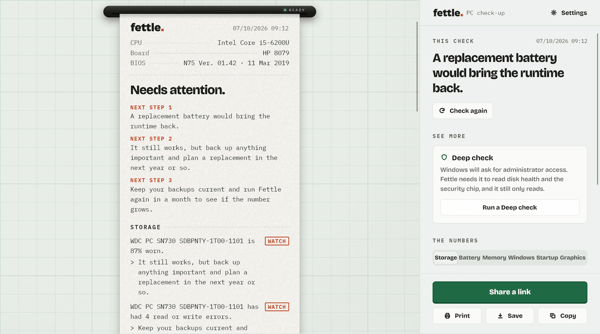
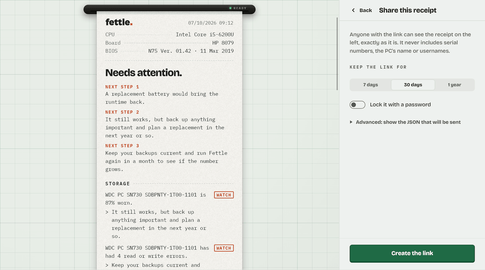
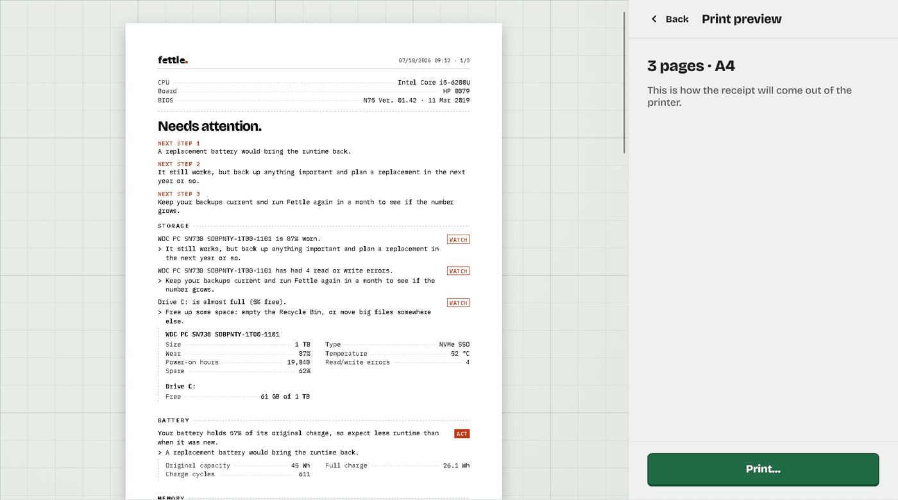

<p align="center">
  <picture>
    <source media="(prefers-color-scheme: dark)" srcset="assets/brand/fettle-wordmark-light.svg">
    
  </picture>
</p>

<p align="center"><b>A free, open-source check-up for Windows PCs, printed as a receipt you can actually read.</b></p>

<p align="center">
  <a href="https://fettle.page/download">Download</a> ·
  <a href="https://fettle.page">Website</a> ·
  <a href="https://fettle.page/changelog">Changelog</a> ·
  <a href="https://fettle.page/code-signing">Code signing policy</a> ·
  <a href="https://fettle.page/privacy">Privacy</a>
</p>

<p align="center">
  <a href="https://github.com/fettle-page/fettle/releases/latest"></a>
  <a href="https://github.com/fettle-page/fettle/actions/workflows/ci.yml"></a>
  <a href="LICENSE"></a>
  
</p>

<p align="center">
  <picture>
    <source media="(prefers-color-scheme: dark)" srcset="assets/screenshots/receipt-dark.png">
    
  </picture>
</p>

Most people can't tell whether their PC is healthy. The tools that could tell them show raw
numbers for people who already know what they mean. Fettle reads what Windows already knows and
prints it as a receipt: a plain-words verdict on every line, the next steps at the top, and the
numbers underneath for anyone who wants them.

Fettle only reads. It doesn't clean, "boost" or change anything, needs no administrator rights,
and sends nothing on its own except the update check, which you can turn off.

## What it checks

| | |
|---|---|
| **Storage** | Wear, errors, temperature and free space, on NVMe and SATA. The optional Deep check reads disk health that needs administrator rights. |
| **Battery** | How much charge it still holds compared with new, and how many cycles it has done. |
| **Memory** | Sticks, slots, speed, and whether a second stick would help. |
| **Windows** | Edition, security updates, Windows 11 readiness, restarts. |
| **Startup** | Everything that starts with Windows. |
| **Graphics** | Your graphics card and how old its driver is. |

If Fettle couldn't check something, the receipt says so, and says why.

## What you can do with the receipt

- **Print it, or save it as a PDF.** The preview shows the pages as they will print, on the paper Windows is set up for.
- **Share it as a link** that lasts 7 days, 30 days or a year, with an optional password. You get a private link to delete it whenever you like. The link opens in any browser, and nobody needs Fettle to read it.
- **Copy it** for a forum, Discord or Reddit, or **save the full report** as JSON.
- Read it **in English or Italian**, with light, dark and OLED themes.

<p align="center">
  
  
</p>

## Download

Fettle runs on Windows 10 and 11 (64-bit). Get it from [fettle.page/download](https://fettle.page/download) or the [releases](https://github.com/fettle-page/fettle/releases):

- **Installer** (`Fettle-Setup-<version>.exe`): installs for your user by default, with no administrator prompt. Remove it from Windows Settings > Apps.
- **Portable zip** (`Fettle-<version>-portable.zip`): nothing to install. It keeps its settings in the `Fettle data` folder beside `fettle.exe`, so a copy on a USB stick leaves nothing behind. Delete the folder to remove it.

**About the Windows warning:** the downloads aren't code-signed yet, so SmartScreen may say "Windows protected your PC" the first time. Choose "More info", then "Run anyway". Every release is built by GitHub Actions from the tagged source, never on someone's own PC. Each release lists the SHA-256 of its files in `SHA256SUMS.txt`, and you can check where a download was built with the [GitHub CLI](https://cli.github.com/):

```sh
gh attestation verify Fettle-Setup-1.0.1.exe --repo fettle-page/fettle
```

The [code signing policy](https://fettle.page/code-signing) explains how releases are built and approved, and why they aren't signed yet.

## What's in this repo

| Path | What it is |
|---|---|
| `crates/fettle-facts` | The report format, in Rust (the app's collectors produce it). JSON Schema and zod are generated from it. |
| `crates/fettle-collect` | The Windows scan: reads every source in parallel, maps it to the report and hides private details. |
| `crates/fettle-verdicts` | The verdict engine: facts in, plain-words verdicts out (English and Italian). |
| `crates/fettle-receipt` | The receipt everyone shows: verdicts, wording and numbers, already in one language. Its copy lives in `copy/*.json`. |
| `crates/fettle-wasm` | The receipt as WebAssembly, for the website build and the share Worker. |
| `apps/windows` | The Windows app (Rust and Slint), and in `packaging/` the installer, the portable zip and the licence notices. |
| `packages/brain` | Loads the WebAssembly receipt in Node and in the Worker; the receipt's TypeScript types, generated from Rust. |
| `packages/report-schema` | The report types and validation for TypeScript (generated from the Rust types). |
| `packages/receipt-ui` | Draws the receipt (React) on the website and share pages. |
| `packages/share-client` | The app's side of share links: upload and delete, tested against the Worker. |
| `apps/web` | The website (Astro, static), including the share page. |
| `worker` | A Cloudflare Worker: serves the website and the share-link API (R2 storage). |
| `spike` | A throwaway Rust CLI used to test Windows data sources. |
| `assets/brand` | Logo and app icon. |
| `.github/workflows` | CI runs every test on each push; a version tag builds the downloads and drafts a GitHub release. |

## Develop

Needs Node 24 and npm, and a stable Rust toolchain (MSVC on Windows) with the WebAssembly target:
the website and the share Worker build their receipts with the same Rust code as the app.

```sh
rustup target add wasm32-unknown-unknown
npm install
npm test                      # every package: unit tests, type checks, site build checks
npm run parity:goldens        # after changing a verdict rule or the copy: refresh the expected receipts
npm run dev:share             # the website + share Worker on http://localhost:8787
node worker/scripts/seed.mjs  # upload a sample report to the local Worker and print its links
cargo test --workspace        # the Rust crates
cargo run -p fettle-collect   # scan this PC and print the report (Windows)
npm run kit                   # build target/fettle-test-kit.zip to run on other PCs
npm run package:windows       # the installer, portable zip and SHA256SUMS.txt in target/package (needs Inno Setup 6)
```

Everything runs locally. The Worker uses local simulations of R2, rate limiting and Durable Objects.

## Releasing

1. Set the version in `apps/windows/Cargo.toml` (the app and its downloads read it there), run cargo once so `Cargo.lock` follows, and write the version's notes in `apps/web/src/content/changelog.ts`.
2. Push the tag `v<version>`. The Release workflow checks the tag matches, runs every test, builds the downloads with a build attestation, and drafts a GitHub release.
3. Publish the draft. Then date the notes, set `published` in `apps/web/src/release.ts` to the version, and deploy the site: its download links and `/app/latest.json` (which tells the app a new version is out) follow `published`, never an unpublished version.

## Privacy

- Reports leave out serial numbers, the PC's name, usernames and network addresses. Product keys are never read.
- A share link uploads only the receipt you see, when you ask. Links expire after 7 days, 30 days or 1 year, can have a password (stored only as a hash), and can be deleted with a private link.
- The website uses no cookies, no analytics and no third-party requests. Fonts are self-hosted.

## Contact and security

- Questions, or an antivirus that flags Fettle: [hello@fettle.page](mailto:hello@fettle.page), or open an issue.
- A security problem (in the app, the website or share links): please write to [security@fettle.page](mailto:security@fettle.page) instead of opening a public issue.
- A share link being misused: [abuse@fettle.page](mailto:abuse@fettle.page).

## Licence

MIT (see `LICENSE`). The Windows app's interface is built with [Slint](https://slint.dev), used under its royalty-free licence (it is also available under GPLv3); the About panel carries its credit. The fonts are under the SIL Open Font License; their licence files are in `apps/web/public/fonts`. The Windows downloads carry `THIRD-PARTY-NOTICES.txt`, the licences of everything built into the app, written at packaging time by `apps/windows/packaging/notices.mjs`.
